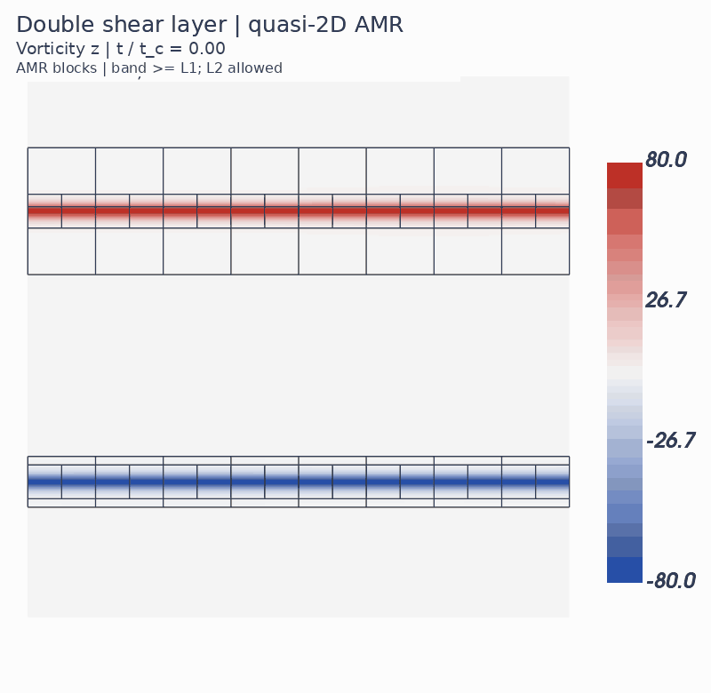
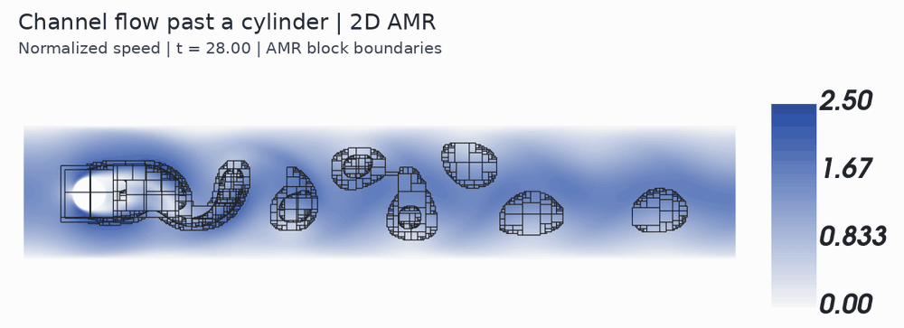

# Open-LBMReX

[English README](README.md)

Open-LBMReX 是基于 AMReX 的研究型格子 Boltzmann 代码库，提供 D2Q9／D3Q27 算例组合、CPU／MPI 与 NVIDIA CUDA 构建路线、cell-centered 块结构 AMR，以及边界、力和流动问题的测试与示例。代码、CMake 工程和可执行目标仍使用 LBMReX 名称。

**`v0.1.0` 实验性快照。** 独立源码快照及新 AMReX 安装包已完成所选 CPU／MPI 与 CUDA 构建和运行检查。动态 AMR 属于实验性能力；必须结合[验证范围](docs/validation.md)与[已知限制](docs/known-limitations.md)解释结果，程序正常退出不等于科学验证通过。

## AMR 效果展示

下面两张动图来自此前的开发运行，展示 AMR 网格随流场变化的过程，黑线表示 AMR 块边界。这些是直观示例，不是本发布版本新增的验证结果；[已知限制](docs/known-limitations.md)仍然适用。

**双剪切层（DSL）**：D3Q27 准二维切片的涡量场，上方条带至少为 L1，允许继续细化到 L2，`t/t_c = 0–2`。



**DFG 通道圆柱绕流**：涡脱落过程中的归一化速度场与尾迹细化区域，`t = 28–35`。



## 项目初衷与发布方式

这是一个出于个人兴趣开展的项目，也是 AI Coding 的学习与实践。分享代码是为了交流和探索，不保证实现或计算结果的正确性，也不保证持续维护与更新。若用于科研或工程工作，请先针对自己的问题独立验证。

LBMReX 的内部代码保存在私有仓库中，并在那里持续开发。本仓库用于发布经过整理的开源代码快照，省略内部开发历史及开发过程中的个人信息，同时保留必要的来源署名、许可声明和已知限制。内部开发版本仍在迭代，发布快照可能落后于内部进展；未来可能继续修正问题、补充功能，但不承诺固定更新周期。

## 架构图

[查看 LBMReX 交互式架构图（英文）](docs/architecture/lbmrex-architecture.html)。该图由 **AI 使用 [Archify](https://github.com/tt-a1i/archify) 根据源码自动生成**，概括执行流程与数据归属，可能存在遗漏或错误，具体行为请以[源码导航](docs/architecture/sources.md)和代码为准。下载 HTML 后用浏览器打开即可使用交互功能。

另有 [关键类与函数导航（英文）](docs/class-diagram/index.html)，分为[单层准备与运行](docs/class-diagram/single-level.html)、[AMR 演化与所有权](docs/class-diagram/amr.html)、[共享场与算子](docs/class-diagram/fields-operators.html)三组类图，同样由 **AI 使用 Archify 自动生成**。图中区分拥有、借用和继承关系，自由函数单独列出；具体声明与缩写说明见[类图源码导航](docs/class-diagram/sources.md)。

## 构建与运行

先阅读[依赖和构建说明](docs/building.md)，独立构建安装 AMReX，再从公开仓库根目录配置 LBMReX：

```bash
cmake -S . -B build/cpu \
  -DCMAKE_BUILD_TYPE=Release \
  -DCMAKE_C_COMPILER=mpicc -DCMAKE_CXX_COMPILER=mpicxx \
  -DAMReX_ROOT=/absolute/path/to/patched-amrex-install \
  -DLBM_ENABLE_CUDA=OFF -DBUILD_TESTING=OFF -DLBM_BUILD_SHOWCASES=ON
cmake --build build/cpu --parallel 4 --target lbm_uniform_flow
OMP_NUM_THREADS=1 ./build/cpu/lbm_uniform_flow \
  showcases/uniform_flow/inputs/inputs.d2q9_guo_velocity_io
```

两种 Descriptor 均链接启用 EB、double precision 的 **3D AMReX** 包。官方子模块固定为 `4ceb814db7d79c5858b13dab153fb04ecc3b129d`；[projected-tags 补丁](patches/amrex/README.md)只应用到独立准备副本，保留子模块干净。CPU 与 CUDA 的 build／install 目录分开。CUDA 需要 CMake 3.26 或更新版本及与固定 AMReX 兼容的 CUDA／主机编译器。

Git clone＋子模块初始化为主要入口；普通无 `.git` 源码包也可配合符合要求的外部 AMReX 安装包使用，不额外提供捆绑 AMReX 的完整源码包。

## 示例与测试

当前五个 showcases 都是**单层网格实例**，部分配置或说明可能尚未跟上后续开发。现有多层网格算例均位于对应的 [tests](tests/README.md) 中，AMR 算例入口见 [numerical tests](tests/numerical/README.md)。未来可能补充多层网格 showcases，但不承诺完成时间。

五个独立科研示例为[均匀流](showcases/uniform_flow/README.md)、[TGV](showcases/taylor_green_vortex/README.md)、[Poiseuille](showcases/poiseuille_flow/README.md)、[方腔流](showcases/lid_driven_cavity/README.md)和[通道圆柱](showcases/channel_cylinder/README.md)。示例的源码、inputs、参考和后处理由各 case 自己维护；Descriptor／Dynamics 由 C++ 组合决定，inputs 只承载该 case 开放的稳定参数。

[Formal tests](tests/README.md)独立拥有其组合与产物；[numerical tests](tests/numerical/README.md)区分工程短程和完整科学比较。长程可能需要先生成匹配的参考结果，普通 `ctest` 会运行所有注册项，请先列出并显式选择测试。

## 当前问题与后续可能的改进

**并行验证范围：** 当前快照已有独立的 CPU MPI 与 CUDA 工程验证，具体版本和范围见[验证说明](docs/validation.md)。受可用计算资源限制，GPU 侧的多设备测试仍仅覆盖 NVIDIA MIG 切片配置，本次快照的多 rank 运行使用同一张物理 A100 上的 MIG 实例。尚未验证多张完整物理 GPU 的并行运行，不能保证此类配置能够正常运行或通过测试。

以下问题仍然存在，未来可能继续修正：

- 动态 AMR 的网格颗粒度、细网格覆盖范围与计算成本之间的取舍仍需改进。
- 部分 Re100 圆柱算例未通过科学判据，或缺少足够的验证证据。
- AMR 力时序中的锯齿现象尚未解决，根因仍未定位。
- GPU 长程验证仍不完整，部分运行曾取消、超时或延期。

完整说明见[已知限制](docs/known-limitations.md)。这些是待解决问题，不代表修复或发布时间的承诺。D3Q27 与准二维算例的工程覆盖不能外推为完整三维科学验证；不同 owner 的 cavity 门槛分别保留，不统一改写。

## 署名、许可与引用

项目由 **no-more-Bug** 使用 AI 编程工具开发和维护，不声称每行生成代码均经人工逐行审查。自有可版权贡献采用标准 [BSD-3-Clause](LICENSE)，AMReX 和第三方参考资料按其原有声明和来源处理，详见[第三方资料](docs/third-party.md)。

参考数值保留文献、单位与处理／读图误差，但未取得单独开放许可；项目 BSD 不覆盖原论文／网站的受保护表达。引用软件时使用 [CITATION.cff](CITATION.cff)，注明实际提交或版本，并引用 AMReX 与所用 benchmark；当前没有项目 DOI。

## 致谢

本项目在学习 LBM 实现和代码组织时，主要参考了 [Palabos](https://gitlab.com/unigespc/palabos)，同时参考了 [waLBerla](https://github.com/lssfau/walberla) 和 [VirtualFluids](https://git.rz.tu-bs.de/irmb/VirtualFluids)，并从 [iLBMReX](https://github.com/haotianh9/iLBMReX)、[vivsim](https://github.com/haimingz/vivsim) 等开源库中学习了许多思路。本项目也依赖 [AMReX](https://github.com/AMReX-Codes/amrex) 提供的基础能力。

开发过程中使用的 AI coding 工具包括但不限于 [Codex](https://github.com/openai/codex)、[pi-coding-agent](https://github.com/earendil-works/pi/tree/main/packages/coding-agent) 和 [DeepSeek Harness](https://github.com/deepseek-ai/deepseek-harness)。

使用的开源 skills 包括但不限于 Matt Pocock 的 [codebase-design](https://github.com/mattpocock/skills/tree/main/skills/engineering/codebase-design)、[improve-codebase-architecture](https://github.com/mattpocock/skills/tree/main/skills/engineering/improve-codebase-architecture)、[grill-with-docs](https://github.com/mattpocock/skills/tree/main/skills/engineering/grill-with-docs)，以及 [Archify](https://github.com/tt-a1i/archify)。

向这些项目的开发者、维护者和贡献者致以诚挚的感谢与敬意。感谢他们公开分享代码、方法、文档与工具，使个人学习和探索成为可能。

## 部分 LBM 参考文献

以下文献是学习网格加密与非均匀网格 LBM 的重要参考:

- [Rohde 等（2006）](https://doi.org/10.1002/fld.1140)：格子 Boltzmann 方法中质量守恒的局部网格加密。
- [Chen 等（2006）](https://doi.org/10.1016/j.physa.2005.09.036)：基于体积表述的 LBM 网格加密。
- [Coreixas 与 Latt（2025）](https://doi.org/10.1016/j.cpc.2025.109833)：采用标准 C++ 并行的 GPU 非均匀网格可压缩 LBM；另有[开放预印本](https://arxiv.org/abs/2504.04465)。
- [Schukmann 等（2025）](https://doi.org/10.3390/fluids10020031)：非均匀网格 LBM 中的伪气动声学辐射。

完整书目信息及 benchmark 来源见[科学参考文献](docs/references.md)。
