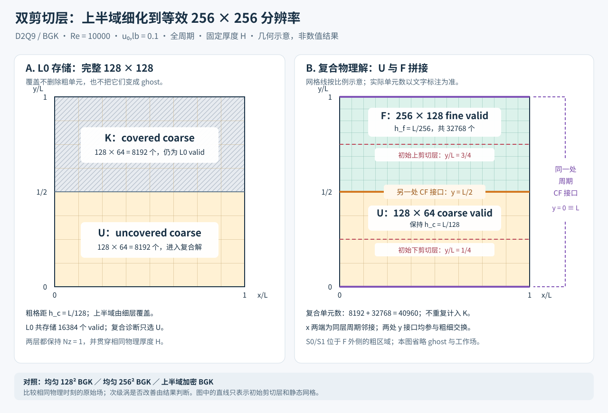

# Double shear layer: static and experimental dynamic AMR

The BGK double-shear case uses Re=10000, lattice velocity scale 0.1, shear parameter kappa=80, perturbation delta=0.05 and a fully periodic domain. D2Q9 and quasi-two-dimensional D3Q27 are separate descriptors; the latter is not full 3D scientific validation.

## Static scientific comparison

Targets are `lbm_numerical_amr_double_shear_layer` and `lbm_numerical_amr_double_shear_layer_d3q27`, using [d2q9](inputs/d2q9) and [d3q27](inputs/d3q27). Build from the [repository root](../../../docs/building.md).

[run.sh](run.sh) takes the two executables, work directory, MPI launcher, an entry `{d2,d3}-{ref128,ref256,ref512,baseline,3l,2r,p1,p2,p3}` and, where required, an explicit matching uniform-reference work directory. It requests the complete 2tc horizon with 41 synchronized frames. It does not offer a general `LBM_TEST_MAX_STEP` short mode and does not silently generate a missing external reference.



The [periodic layouts](figures/periodic-double-shear-layouts.svg) and [multilevel/multiregion layouts](figures/multilevel-multiregion-double-shear-layouts.svg) explain the six AMR layouts; they are not computed grids or fields. Use ref256/ref512 as the matching primary uniform comparison and ref128 only in its documented auxiliary role.

Static `double-shear-v1` artifacts include identity, layout/sampling records and native frames. Fourth-order vorticity reconstruction is used for its static interface diagnostic. At the 11 Minion open-circle times through tc, energy and enstrophy budgets are 1% and 10%, plus the CSV absolute readout uncertainty. AMR-to-matching-uniform comparisons use 41 frames with 1% energy and 5% enstrophy budgets; conservation/quasi-two-dimensional budgets are 1e-10. No literature points exist beyond tc in these figures. [Reference provenance](reference-data/README.md) defines normalization, pixel mapping and uncertainty; PSpect is auxiliary, not a stronger reference.

## Experimental dynamic and minimum-band entries

| Route | Targets / inputs | Contract |
| --- | --- | --- |
| Dynamic DSL | `lbm_numerical_dynamic_double_shear_layer{,_d3q27}`; `inputs/dynamic_d2q9`, `inputs/dynamic_d3q27`; entries `{d2,d3}-{2l,3l}`. | `dynamic-double-shear-v1`; full 2560 L0 steps/41 frames. Short mode is bounded data checking. The dynamic checker uses 0/2 for its data contract, not static scientific budgets. |
| Minimum fixed band | `lbm_fixed_band_dsl_d2`, `lbm_fixed_band_dsl_d3`; `inputs/fixed_band_*`; entries `{d2,d3}-fixed-band`. | Current `fixed-band-double-shear-v2` requires at least L1 in the band and permits L2 there. Older v1 artifacts retain their older meaning. 0/1/2 qualifies coverage/data relations, not scientific error or speedup. |

[run_dynamic.sh](run_dynamic.sh) accepts `LBM_TEST_MAX_STEP` and selects its short consumer mode when bounded. The existing minimum-band short registration uses 128 L0 steps. With explicit matching executables, this is a bounded dynamic entry:

```bash
LBM_TEST_MAX_STEP=32 LBM_TEST_AMR_MPI_RANKS=2 \
bash tests/numerical/amr_double_shear_layer/run_dynamic.sh \
  build/cpu/tests/numerical/lbm_numerical_dynamic_double_shear_layer \
  build/cpu/tests/numerical/lbm_numerical_dynamic_double_shear_layer_d3q27 \
  build/cpu/tests/numerical/work/manual-dynamic-dsl \
  "$(command -v mpirun)" d2-2l
```

Build the named dynamic targets first. The minimum-band inputs currently use grid efficiency 0.8 and their documented refinement cadence/buffer/hysteresis; do not turn minimum coverage into a prohibition of finer coverage.

Dynamic observational reference comparison permits recorded source/backend differences while requiring matching descriptor, domain, time and resolution; it preserves both identities and is not a same-SHA scientific qualification. Dynamic diagnostics use a second-order native composite/MC treatment. They are not interchangeable with the static fourth-order curl curves. Grid granularity, expanded fine coverage and incomplete GPU long-run evidence remain [limitations](../../../docs/known-limitations.md). Every command still needs [standalone snapshot validation](../../../docs/validation.md).
