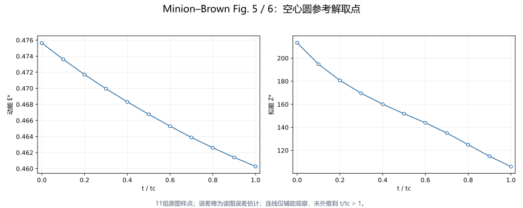

# Minion–Brown Figures 5/6: digitized numerical references

Michael L. Minion and David L. Brown, *Performance of Under-resolved Two-Dimensional Incompressible Flow Simulations, II*, *Journal of Computational Physics* 138, 734–765 (1997), [doi:10.1006/jcph.1997.5843](https://doi.org/10.1006/jcph.1997.5843).

The primary reference is the figures' **open-circle series**. The labelled PSpect curve is an auxiliary 128×128 calculation and must not replace those points. These files are digitized readings, not author-provided raw output, analytical solutions or newly computed reference solutions. Their literature time range is only \(0\le t/t_c\le1\).

| File | Role | SHA256 |
| --- | --- | --- |
| [fig5-6-open-circle-reference.csv](fig5-6-open-circle-reference.csv) | 11 energy/enstrophy pairs at nominal times 0,0.1,…,1. | `0cee6f1346f68ad830082d6a19ff94dbbf4bdbb2ab69c5247c4e0e558a20aef5` |
| [fig5-6-pspect-auxiliary.csv](fig5-6-pspect-auxiliary.csv) | 21 auxiliary pairs at 0,0.05,…,1; not primary quantitative acceptance. | `386fca9675992be3c649e6a8071094e98c5e9481aa15358b17df1f7da2156534` |

The files retain their original bytes, including uncertainty columns. This directory is the numerical test's reference owner; checkers do not search a private paper archive or silently fall back to another copy.

Line segments in this redraw are display aids, not additional source samples. The original figure overlay and publisher PDF are not distributed. No separate open redistribution licence has been obtained for the original source; project BSD does not cover the paper/figure expression. See [third-party material](../../../../docs/third-party.md).

## Extraction and calibration

Section 5 describes the thin shear layer with steepness 80, perturbation 0.05, physical viscosity 0.0001 and periodic unit square; with L=U0=1 this is Re=10000. Figures 5 and 6 are on printed pages 751 and 752. Do not infer an unreported grid identity for the open circles from a different thick-layer discussion.

The source PDF digest is `39f673c35869beebe3183b47d88e04cb2a0362ad6f09e0e9b43ebc38c7b4859d`. Native 1-bit figure rasters were extracted with Poppler `pdfimages`: 1526×1170 and 1527×1179 pixels, approximately 318 dpi. Interpolated enlargement was not treated as additional resolution. Extracted raster digests are `1a62cc193887d19aff677b34b49aca5169debfb18c98e1097968cd52df9ea34c` and `9ab751ab4ca4e5a4b12fcc3960e17d177d591fab4d3baddfc43df9580bdbe8f4`; these are provenance identifiers, not runtime files supplied here.

Pixel coordinates start at the upper-left, x to the right and y downward. Affine mappings fitted labelled axis ticks and accounted for slight tilt; the unlabelled right boundary was not used for time calibration. Circle centers/radii were fitted to their circumference pixels rather than using the top/bottom edge as the reading. The CSV retains each figure's pixel coordinates and separately mapped times; t=0 was not replaced by an analytical initial value.

For \(q=a_xx+a_yy+a_0\):

| Mapping | a_x | a_y | a_0 | Maximum tick residual |
| --- | ---: | ---: | ---: | ---: |
| Fig. 5 time | 0.000875362205589275 | 5.88542437101591e-06 | -0.129139243795676 | 0.000692865 |
| Fig. 5 energy | 1.34611239775609e-08 | -2.82169588390418e-05 | 0.480391920425237 | 3.93652e-05 |
| Fig. 6 time | 0.000858997833800368 | 5.35534883021056e-06 | -0.104711608791073 | 0.000481165 |
| Fig. 6 enstrophy | 5.80639556883756e-06 | -0.124527517672563 | 215.543347896042 | 0.138284 |

Auxiliary PSpect readings use local fits to actual dark pixels in the identified trace band. Where overlapping curves cannot be separated at native resolution, uncertainty is enlarged. The t=0 endpoint uses a local trace extension, marked `axis_endpoint_local_trace`. Auxiliary readings are not more precise than the primary circles.

## Fields and uncertainty

`time` is nominal t/tc. `energy` and `enstrophy` are direct axis readings, not values refitted to theory or divided by their initial values. `energy_readout_abs`, `enstrophy_readout_abs` and `time_readout_abs` are estimated absolute readout uncertainties, **not statistical confidence intervals or scientific thresholds**. The `*_time_from_pixels` and `*_x_px/*_y_px` fields retain the independent mapped times and raster positions. `method` distinguishes the extraction procedure.

Primary uncertainties include one native pixel of center localization, axis-fit residual and the vertical effect of time-position uncertainty estimated from neighboring primary points independently of PSpect. The energy readout estimate ranges from ±0.000086 to ±0.000119; enstrophy from ±0.381 to ±0.572; time is ±0.001568. These estimates exclude both the original paper's discretization error and a future LBM result's error. Extra printed digits preserve reproducibility of the mapping, not extra physical precision.

## Project normalization and use

The comparison convention is
$$
E^*=\frac{\langle|\boldsymbol u|^2\rangle}{2u_0^2},
\qquad
Z^*=\frac{L^2\langle|\nabla\times\boldsymbol u|^2\rangle}{u_0^2}.
$$

It uses velocity squared without instantaneous density; enstrophy has no factor 1/2. D2 uses area weighting and quasi-D3 uses actual volume weighting, excluding covered coarse and ghost cells. Square locally before integrating; do not first average in z. These are project definitions, not a reconstruction of the published readings from formulas.

For the static test, L=U0_phys=1, nu_phys=1e-4 and u0_lb=0.1. L0=128 gives dt0/tc=1/1280; 41 frames through 2tc contain all 11 primary nominal times. Literature comparison uses only those 11 times, with energy 1% and enstrophy 10% relative budgets plus the primary CSV absolute readout uncertainty. For 1<t/tc≤2 there are no literature points from these figures; use the explicit matching uniform-fine reference. The 41-frame AMR/uniform comparison uses energy 1% and enstrophy 5%, without adding literature readout uncertainty.

Energy/enstrophy curves alone cannot prove the absence of secondary vortices. Static fourth-order interface curl and dynamic second-order native composite diagnostics are different contracts; see the [case README](../README.md).
