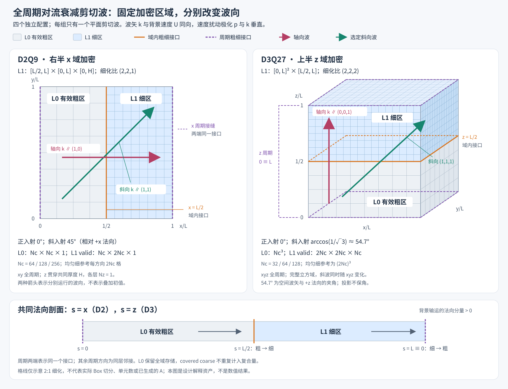

# Static AMR periodic shear

This BGK decay/interface test has D2Q9 and genuinely xyz-varying D3Q27 periodic shear modes. It is not an acoustic validation. D2 coarse resolutions are 64/128/256; D3 uses 32/64/128. Complete runs end at physical t=4 with principal comparisons at t=1,2,4.

Targets are `lbm_numerical_amr_periodic_shear` and `lbm_numerical_amr_periodic_shear_d3q27`. Inputs are [d2q9](inputs/d2q9) and [d3q27](inputs/d3q27).

## Explicit groups

After the [root build](../../../docs/building.md), [run.sh](run.sh) takes the two executable paths, a work directory, an MPI launcher and one group:

```text
d2-axis | d2-diagonal | d3-axis | d3-diagonal
```

Each group explicitly runs its uniform-reference and half-domain AMR resolution matrix. Diagonal groups additionally contain complex-interface layouts. This is not an arbitrary runner that silently fills missing references; the group is the stated computation. It requests the complete horizon, so `LBM_TEST_MAX_STEP` is not a universal short mode here.

## Geometry and independent comparison

The analytical reference is the decaying shear's cell average, compared at matching times with uniform-fine runs. It is not the exact finite-Mach, finite-spacing solution of the discrete LBM. Geometry, population identities and independent expected wave direction/decay remain test-owned.



[Complex D2 layouts](figures/periodic-shear-complex-regions-d2.svg) and [complex D3 layouts](figures/periodic-shear-complex-regions-d3.svg) are schematic geometry explanations, not computed field results.

## Scoped criteria and artifacts

The scales are L=1, rho0=1, U=0.05, initial velocity amplitude a_u=0.001 and viscosity nu=1/1280. Velocity errors are normalized by the fixed initial a_u, and pressure errors by rho0*c_s*a_u, not by the decaying instantaneous amplitude.

For the finest half-domain and D2 complex configurations, the velocity global-L2, interface-L∞, pressure-peak and velocity four-point peak budgets are 1%, 5%, 1% and 1%. D3 complex configurations use 1%, 6%, 1.5% and 3%, respectively. Pressure four-point error is 1% and mass/momentum budgets are 1e-10. Coarser-resolution errors are reported and are not silently promoted to additional hard criteria.

Artifacts use `periodic-shear-v1`, with identity, layout/sampling records and native frames. [check_periodic_shear.py](check_periodic_shear.py) and [shear_metrics.py](shear_metrics.py) determine eligibility and scoped comparisons. Follow the [common 0/1/2 contract](../README.md) and [standalone validation status](../../../docs/validation.md).
